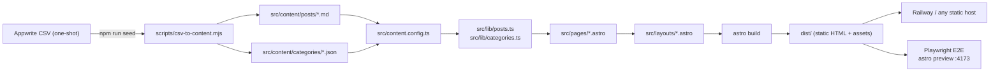

# Mindful

Short, gentle reads for everyday mental wellbeing. A static-first Astro blog —
accessible, SEO-tuned, mobile/PWA-ready — with a minimalist editorial feel.

> Mindful is **not** a substitute for professional mental-health care. If you are
> in crisis, please contact your local emergency services or a trusted helpline.

---

## Stack at a glance

- **Astro 6** (`output: 'static'`) with TypeScript strict mode and Content Collections
- **Tailwind CSS v4** (via `@tailwindcss/vite`) with design tokens in `src/styles/global.css`
- **MDX** and **Sitemap** integrations
- **Hand-rolled PWA**: `public/manifest.webmanifest` + `public/sw.js` (no framework runtime)
- Fonts: self-hosted **Fraunces** (display) + **Newsreader** (body) via Fontsource
- Tooling: **ESLint 9 flat config** (Astro + jsx-a11y + typescript-eslint), **Prettier**
  with astro + tailwind plugins
- **E2E: Playwright** (`@playwright/test`) against `astro preview` on a dedicated port
  (`4173`) so tests never fight `astro dev` on `4321`
- Deploy: Railway via the repo `Dockerfile` (non-root, bundled `serve`,
  security headers from `public/serve.json`); portable to any static host

Zero framework runtime ships to the browser. First-paint JS is ~2.2 KB (Astro's
prefetch helper) plus the service worker.

## Architecture



The CSV is the original import only. After the first `npm run seed`, markdown in
`src/content/posts/` is the source of truth. Rerunning the seed overwrites files.

## Repository layout

```text
.
├── playwright.config.ts       Playwright: webServer build+preview on 127.0.0.1:4173, chromium + mobile
├── e2e/                       End-to-end specs (home, menu dialog, routes, footer nav)
├── astro.config.mjs         Astro + integrations (mdx, sitemap), Tailwind + image allowlist
├── eslint.config.mjs        Flat ESLint config (astro + jsx-a11y + ts + prettier)
├── .prettierrc              Prettier + astro/tailwind plugin config
├── tsconfig.json            Strict TS, path alias `~/*` -> src/*
├── railway.json             Railway build + start commands
├── Dockerfile               Multi-stage node:22-alpine build (optional)
├── public/
│   ├── favicon.svg          Source logo (rasterised into /public/icons by script)
│   ├── icons/*.png          PWA icons (192/512/maskable-512)
│   ├── manifest.webmanifest PWA manifest
│   ├── robots.txt           Sitemap pointer
│   └── sw.js                Service worker (network-first HTML, SWR assets)
├── scripts/
│   ├── csv-to-content.mjs   One-shot CSV -> markdown import
│   ├── generate-icons.mjs   Rasterise favicon.svg into PWA icons (uses sharp)
│   └── init-env.mjs         Copy .env.example -> .env if missing
└── src/
    ├── components/
    │   ├── CategoryChip.astro   Pill using category accent token
    │   ├── Disclaimer.astro     Reusable "not medical advice" note
    │   ├── Footer.astro         Bottom nav via NavLinks
    │   ├── Header.astro         Sticky header + native <dialog> menu
    │   ├── NavLinks.astro       Shared nav (footer + menu stay in sync)
    │   ├── PostCard.astro       Card used on home + category index; hero image links to the post
    │   └── Seo.astro            <title>, OG, Twitter, JSON-LD
    ├── config/
    │   └── site.ts              Site-level constants (name, tagline, nav)
    ├── content/
    │   ├── categories/*.json    Category metadata
    │   └── posts/*.md           Blog posts
    ├── content.config.ts        Zod schemas + collection loaders
    ├── layouts/
    │   ├── BaseLayout.astro     <html>, head, SEO, SW registration
    │   └── ArticleLayout.astro  Article chrome (header, prose, prev/next)
    ├── lib/
    │   ├── categories.ts        getCategories / getCategory
    │   └── posts.ts             getPublishedPosts / getFeaturedPost / getAdjacentPosts / formatDate / readingMinutes
    ├── pages/
    │   ├── 404.astro            Not-found (noindex)
    │   ├── about.astro
    │   ├── categories/[slug].astro
    │   ├── disclaimer.astro
    │   ├── accessibility.astro
    │   ├── privacy.astro
    │   ├── terms.astro
    │   ├── index.astro          Home (hero + featured + grid)
    │   ├── offline.astro        SW fallback (noindex)
    │   └── posts/[slug].astro   Article renderer
    └── styles/
        └── global.css           Tailwind import + @theme tokens + .prose + grain overlay
```

## Getting started

```bash
nvm use                 # Node 22 (see .nvmrc)
npm install
npm run init:env        # copies .env.example -> .env if missing
npm run dev
```

Open [http://localhost:4321](http://localhost:4321).

Environment variables:

| Variable   | Default                       | Purpose                                         |
| ---------- | ----------------------------- | ----------------------------------------------- |
| `SITE_URL` | `https://mindful.example.com` | Canonical, OG, and sitemap base URL             |
| `PORT`     | `3000`                        | `npm start` static server port (set by Railway) |
| `CSV_PATH` | `~/Downloads/mindful-...csv`  | Override for `npm run seed`                     |

## Scripts

| Script                | What it does                                                       |
| --------------------- | ------------------------------------------------------------------ |
| `npm run dev`         | Astro dev server with HMR                                          |
| `npm run build`       | Build static site into `dist/`                                     |
| `npm run preview`     | Preview the built site locally                                     |
| `npm start`           | Serve `dist/` on `$PORT` (Railway-ready)                           |
| `npm run seed`        | Re-import posts + categories from the Appwrite CSV                 |
| `npm run icons`       | Rasterise `public/favicon.svg` into PWA icon PNGs                  |
| `npm run check`       | `astro check` + `tsc --noEmit`                                     |
| `npm run lint`        | ESLint over the repo                                               |
| `npm run lint:fix`    | ESLint with `--fix`                                                |
| `npm run format`      | Prettier write                                                     |
| `npm run fix`         | `lint:fix` then `format`                                           |
| `npm run init:env`    | Copy `.env.example` to `.env` if missing                           |
| `npm run test:e2e`    | Playwright: build, serve preview on **4173**, run all E2E projects |
| `npm run test:e2e:ui` | Playwright UI mode                                                 |

## End-to-end tests (Playwright)

First-time setup installs browser binaries:

```bash
npx playwright install chromium
```

`playwright.config.ts` runs `npm run build && npm run preview -- --host 127.0.0.1 --port 4173`
and points tests at `http://127.0.0.1:4173`. The web server sets `SITE_URL` to that
same base URL when the variable is unset so `astro build` succeeds without a local
`.env` (override via `.env` or the environment if you need a different canonical URL
in generated metadata). Port **4173** is intentional so a local `astro dev` on
**4321** does not steal the preview port (if preview falls back to another port,
`baseURL` would no longer match and tests can 404).

Coverage (see `e2e/*.spec.ts`):

- Home: single `h1`, `#main` landmark, skip link → `#main`, header/footer
- Hamburger `<dialog#site-menu>`: open/close `aria-expanded`, navigate to About,
  Escape closes
- Routes: sample post (`/posts/what-is-mindfulness`), a second post slug used for
  SEO rewrites (`/posts/how-to-calm-anxiety`), category (H1 = category **label** in
  `categories/[slug].astro`), About, Disclaimer, `/offline`,
  `/sitemap-index.xml`, 404 page
- Footer: category link, utility links (about, legal pages, etc.)

Projects: **chromium** (desktop) and **mobile** (Pixel 5 Chromium profile).

## Content authoring

### Add a post

Create `src/content/posts/<slug>.md`. The filename is the URL slug.

```md
---
title: A plain sentence that becomes the H1
excerpt: One or two sentences for the card and meta description.
category: mindfulness # must match a category id (see list below)
publishedAt: 2026-04-18 # ISO date; Date object is parsed by Zod
updatedAt: 2026-04-19 # optional
image: https://picsum.photos/seed/your-seed/1200/600 # optional, URL only
imageAlt: Describe the image for screen readers # optional
featured: false # at most one post is shown as the hero
reviewRequired: false # editorial flag (for your own tracking)
draft: false # true = excluded from build lists and sitemap
---

The body is plain markdown. First paragraph gets a drop cap via `.prose` styles.
Use `##` and `###` for section headings; H1 is reserved for the page title.
```

Valid categories (see `src/content/categories/*.json`):
`anxiety-stress`, `mindfulness`, `relationships`, `self-care`, `sleep-rest`.

### Add a category

Create `src/content/categories/<id>.json` with:

```json
{
  "id": "new-category",
  "label": "Display Label",
  "description": "Short description shown on the category page.",
  "accent": "#6B8E7F"
}
```

Then add `"new-category"` to the `CATEGORY_IDS` tuple in
[src/content.config.ts](src/content.config.ts) so the enum accepts it.

### Drafts

`draft: true` excludes a post from the homepage list, category pages, and
sitemap. It is also **not** rendered as an HTML page by the build.

### Rich content (optional)

`@astrojs/mdx` is installed. Rename to `.mdx` and import Astro components inside
the article when you need charts, callouts, or embedded widgets.

## Design contract

Tokens live in [src/styles/global.css](src/styles/global.css) inside
`@theme { ... }`. Use them as CSS variables (`var(--accent)`) so dark mode and
future palette changes "just work":

| Token       | Light     | Dark      | Used for                 |
| ----------- | --------- | --------- | ------------------------ |
| `--bg`      | `#F7F3EC` | `#14171A` | Page background          |
| `--surface` | `#FFFFFF` | `#1A1E22` | Card and dialog surfaces |
| `--ink`     | `#1F2A24` | `#ECE7DD` | Primary text             |
| `--muted`   | `#5A6560` | `#9AA39D` | Secondary text           |
| `--rule`    | `#E6DFD2` | `#2A2F33` | Hairlines, borders       |
| `--accent`  | `#6B8E7F` | `#9FC2B3` | Sage accent, focus ring  |
| `--warm`    | `#C9875B` | `#E0A37B` | Terracotta hover accent  |

Font stack:

- `--font-display`: **Fraunces Variable** (opsz + SOFT axes). Used for headings
  and brand. Set `font-variation-settings` when you care about optical size.
- `--font-serif`: **Newsreader Variable**. Default body and UI.
- `--font-sans`: system fallback for small meta text if you ever need it.

Other conventions:

- Measure `max-width: 66ch` on article bodies via the `.prose` class.
- Staggered entrance: add `rise rise-1 / rise-2 / rise-3` classes to hero
  elements for a 0–300 ms fade-rise.
- A SVG grain overlay is attached via `body::before`; do not override it.

## Accessibility contract

All pages must:

- Have exactly **one** `<h1>` and logical heading order.
- Use landmark regions (`<header>`, `<nav>`, `<main>`, `<footer>`, `<article>`).
- Include a skip link (already in `BaseLayout.astro`).
- Have visible `:focus-visible` rings (2 px accent, 2 px offset — global rule).
- Respect `prefers-reduced-motion` (all animations gated by a media query in
  `global.css`) and `prefers-color-scheme`.
- Give every meaningful image an `alt`; decorative images use `alt=""`.
- Mark active nav items with `aria-current="page"`.

Linted via `eslint-plugin-astro` + the `jsx-a11y` preset it re-exports.

## SEO contract

[src/components/Seo.astro](src/components/Seo.astro) emits:

- `<title>`, `<meta name="description">`, canonical link
- Open Graph (title, description, type, url, site_name, locale, image, article:)
- Twitter Card (summary / summary_large_image when an image is provided)
- JSON-LD passed via the `jsonLd` prop (objects or arrays)

Per-page JSON-LD already wired:

- Home: `WebSite`
- Category: `CollectionPage`
- Post: `Article` (via `ArticleLayout.astro`)

`robots.txt` allows all and points to `/sitemap-index.xml`. `@astrojs/sitemap`
emits `/sitemap-index.xml` + `/sitemap-0.xml` automatically.

## PWA

- Manifest: [public/manifest.webmanifest](public/manifest.webmanifest)
  (`name`, `theme_color: #6B8E7F`, `background_color: #F7F3EC`, icons).
- Service worker: [public/sw.js](public/sw.js).
  - HTML requests: **network-first**, fall back to `/offline` on failure.
  - Static assets (CSS, JS, fonts, images): **stale-while-revalidate**.
  - Same-origin only; only `ok`, `basic`, non-redirected responses enter the
    cache so error/opaque responses can't poison it.
  - Registered from `BaseLayout.astro` on HTTPS, `localhost`, or `127.0.0.1`.
- Runtime security headers: [public/serve.json](public/serve.json) (HSTS, CSP,
  `X-Content-Type-Options`, `Referrer-Policy`, `Permissions-Policy`, frame
  lockdown) — read automatically by `serve`.
- Icons are regenerated from `public/favicon.svg` with `npm run icons`.

## Deploying

### Railway (default)

`railway.json` points Railway at the repo `Dockerfile`:

```jsonc
{
  "build": { "builder": "DOCKERFILE", "dockerfilePath": "Dockerfile" },
}
```

The multi-stage image uses `node:22-alpine`, installs deps with
`--ignore-scripts`, drops to the non-root `node` user for runtime, and starts
the bundled `serve` pointed at `dist/`. Security headers come from
`public/serve.json`. **Set `SITE_URL`** in the Railway project variables — the
build throws when it is missing. The Dockerfile declares `ARG SITE_URL` so
Railway forwards the service variable to the build step (without the `ARG`,
Docker service variables only reach the runtime container).

### Docker (anywhere else)

The same `Dockerfile` runs on any container host:

```bash
docker build -t mindful .
docker run --rm -p 3000:3000 -e SITE_URL=https://example.com mindful
```

### Any other static host

It's a plain `dist/` directory. Netlify, Cloudflare Pages, Vercel, GitHub Pages,
S3+CloudFront, nginx, Caddy — all work with no code changes. Just set
`SITE_URL` and point the host at `dist/`.

## Troubleshooting

- **Build fails on a post with "expected date, received string"**: the
  `publishedAt` field is missing or malformed. Use ISO 8601.
- `**npm run seed` writes nothing\*\*: set `CSV_PATH` if your CSV is not at
  `~/Downloads/mindful-from-appwrite-april-2026.csv`.
- `**z` is deprecated warnings\*\*: you're importing from `astro:content` or
  `astro:schema`. Import from `astro/zod` instead.
- **Service worker doesn't register**: SWs require HTTPS. On plain `http://`
  (non-localhost), the registration is a guarded no-op by design.
- `**picsum.photos` is slow or rate-limited\*\*: replace with optimised local
  images; update the `remotePatterns` allowlist in `astro.config.mjs` if you
  add a new remote host.
- **Playwright: browser not installed**: run `npx playwright install chromium`
  (or `npx playwright install` for all browsers).
- **E2E 404 on sitemap**: another process may be bound to the E2E preview
  port; stop stray `astro preview`/`dev` processes or ensure `4173` is free.

## Roadmap

- Postgres-backed content (swap the `glob` loader for a DB loader).
- Local/optimised images (replace `picsum.photos` placeholders with
  `astro:assets`).
- Static search (MiniSearch indexed at build time).
- Expand Playwright coverage (e.g. article prev/next, theme color meta) as needed.

## Licence

All rights reserved by the project owners (no public licence applied yet).
