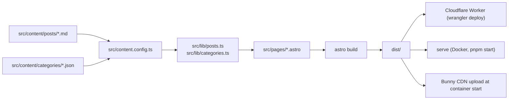

# Mindful

Mindful is a small blog of short, gentle essays about everyday mental wellbeing: anxiety and stress, mindfulness, relationships, self-care, and rest. It is a static Astro site built to be accessible, quick to load, and easy to find in search. It also installs as a PWA and keeps working offline for pages you have already visited.

Live at https://mindful.engg.app, served by a Cloudflare Worker (static assets) on the sg208 account. `wrangler.jsonc` holds the config. `pnpm run deploy` sets `SITE_URL=https://mindful.engg.app`, builds, and runs `wrangler deploy`; it needs a global `wrangler` (v4) plus `CLOUDFLARE_API_TOKEN` and `CLOUDFLARE_ACCOUNT_ID` in the environment.

> Mindful is **not** a substitute for professional mental-health care. If you are in crisis, please contact your local emergency services or a trusted helpline.

## Stack

The site runs on Astro 7 with `output: 'static'`, TypeScript in strict mode, and Content Collections validated by Zod. Styling is Tailwind CSS v4 through `@tailwindcss/vite`, with design tokens in `src/styles/global.css`. Posts are markdown (MDX works too), and `@astrojs/sitemap` writes the sitemap. Fraunces and Newsreader are self-hosted through Fontsource.

No framework runtime reaches the browser. The only JavaScript is Astro's prefetch helper, a small inline script for the menu dialog, and a hand-written service worker in `public/sw.js`.

Tooling is pnpm 10 on Node 24, ESLint 10 (flat config with the Astro, jsx-a11y and typescript-eslint presets), Prettier with the Astro and Tailwind plugins, Vitest for unit tests and Playwright for end-to-end tests.

## How content becomes a page



Markdown files in `src/content/posts/` are the source of truth. The posts were first imported from an Appwrite CSV export with `pnpm seed`, but that was a one-time migration and running it again overwrites files.

## Where things live

| Path                    | What it holds                                                                              |
| ----------------------- | ------------------------------------------------------------------------------------------ |
| `src/pages/`            | Routes: home, `posts/[slug]`, `categories/[slug]`, legal pages, `offline`, `404`           |
| `src/layouts/`          | `BaseLayout` (head, SEO, skip link, SW registration) and `ArticleLayout`                   |
| `src/components/`       | Header with a native `<dialog>` menu, footer, shared `NavLinks`, `Seo`, cards, disclaimer  |
| `src/content/`          | Posts and category JSON                                                                    |
| `src/content.config.ts` | Zod schemas and the list of valid category ids                                             |
| `src/lib/`              | Post and category helpers, with their unit tests                                           |
| `src/config/site.ts`    | Site name, tagline, theme colour, nav links                                                |
| `public/`               | Manifest, service worker, `serve.json` security headers, icons                             |
| `scripts/`              | Seed import, icon generation, `.env` setup, CDN upload; testable helpers in `scripts/lib/` |
| `tests/unit/`, `e2e/`   | Vitest unit tests and Playwright specs                                                     |

## Getting started

You need Node 24 (see `.nvmrc`) and pnpm 10. The exact pnpm version is pinned in `package.json`, so `corepack enable` will pick it up.

```bash
nvm use
corepack enable
pnpm install
pnpm init:env     # copies .env.example to .env if you don't have one
pnpm dev
```

Then open http://localhost:4321.

### Environment variables

| Name                       | Used by                     | Notes                                                                                           |
| -------------------------- | --------------------------- | ----------------------------------------------------------------------------------------------- |
| `SITE_URL`                 | `astro build`               | Base for canonical links, Open Graph tags and the sitemap. A production build fails without it. |
| `PORT`                     | `pnpm start`, Docker        | Port for the static server. Railway sets it if you run the Docker image there.                  |
| `CSV_PATH`                 | `pnpm seed`                 | Location of the Appwrite CSV if it isn't in `~/Downloads`.                                      |
| `BUNNY_STORAGE_ACCESS_KEY` | `scripts/upload-to-cdn.mjs` | Storage zone password for uploads.                                                              |
| `BUNNY_API_KEY`            | `scripts/upload-to-cdn.mjs` | Account key used to purge the pull zone.                                                        |
| `BUNNY_ZONE_ID`            | `scripts/upload-to-cdn.mjs` | Numeric pull-zone id.                                                                           |

If any of the Bunny variables are missing, the upload step logs a warning and the server starts anyway.

## Scripts

| Command            | What it does                                                       |
| ------------------ | ------------------------------------------------------------------ |
| `pnpm dev`         | Astro dev server with hot reload on port 4321                      |
| `pnpm build`       | Static build into `dist/` (needs `SITE_URL`)                       |
| `pnpm preview`     | Serve the built site locally                                       |
| `pnpm start`       | Upload `dist/` to the CDN, then serve it on `$PORT`                |
| `pnpm check`       | `astro check` followed by `tsc --noEmit`                           |
| `pnpm lint`        | ESLint; `pnpm lint:fix` applies fixes                              |
| `pnpm format`      | Prettier write; `pnpm format:check` only reports                   |
| `pnpm fix`         | `lint:fix` and then `format`                                       |
| `pnpm test`        | Vitest unit tests, once                                            |
| `pnpm test:watch`  | Vitest in watch mode                                               |
| `pnpm test:e2e`    | Playwright: builds, starts a preview on port 4173, runs every spec |
| `pnpm test:e2e:ui` | Playwright UI mode                                                 |
| `pnpm icons`       | Regenerates the PWA icons from `public/favicon.svg` with sharp     |
| `pnpm seed`        | Re-imports posts and categories from the Appwrite CSV (overwrites) |
| `pnpm init:env`    | Copies `.env.example` to `.env` if it's missing                    |

## Tests

Unit tests run on Vitest and need no browser:

```bash
pnpm test
```

They cover the post helpers (draft filtering, date sorting, the featured-post fallback, previous/next links, reading time, date formatting), the category helpers, and the pure parts of the scripts: the CSV parser, the frontmatter builder that escapes untrusted CSV values, and the CDN path encoding. Astro's `astro:content` module only exists inside Astro's build, so `vitest.config.ts` points it at a stub in `tests/stubs/` and each test mocks `getCollection`.

End-to-end tests use Playwright. Install the browser once, then run them:

```bash
pnpm exec playwright install chromium
pnpm test:e2e
```

Playwright builds the site and starts `astro preview` on `127.0.0.1:4173`, so it never collides with a dev server on 4321. If `SITE_URL` is unset it uses that preview address. The command passes `--ignore-lock` because Astro 7 otherwise moves `astro preview` into the background when it detects a coding agent, and Playwright then thinks the server died. The specs check the home page landmarks and skip link, the menu dialog (open, close, Escape, navigation), post, category and info pages, `/offline`, the sitemap, the 404 page and the footer links, on both a desktop and a Pixel 5 profile.

There is no CI workflow yet, so run `pnpm lint`, `pnpm check`, `pnpm test` and `pnpm test:e2e` before you merge.

## Writing content

### Adding a post

Create `src/content/posts/<slug>.md`. The filename becomes the URL.

```md
---
title: A plain sentence that becomes the H1
excerpt: One or two sentences for the card and meta description.
category: mindfulness # must match a category id
publishedAt: 2026-04-18 # ISO date
updatedAt: 2026-04-19 # optional
image: https://picsum.photos/seed/your-seed/1200/600 # optional, http(s) URL
imageAlt: Describe the image for screen readers # optional, falls back to the title
featured: false # the featured post becomes the home page hero
reviewRequired: false # editorial flag
draft: false # true hides the post from every list, the sitemap and the build
---

The body is plain markdown. The first paragraph gets a drop cap.
Use `##` and `###` for sections; the H1 is the title.
```

The valid categories are `anxiety-stress`, `mindfulness`, `relationships`, `self-care` and `sleep-rest`. Run `pnpm check` after editing; it reports any frontmatter that doesn't match the schema. If you rename the post `.mdx` you can import Astro components inside it.

### Adding a category

Create `src/content/categories/<id>.json`:

```json
{
  "id": "new-category",
  "label": "Display Label",
  "description": "Short description shown on the category page.",
  "accent": "#6B8E7F"
}
```

Then add the id to the `CATEGORY_IDS` tuple in `src/content.config.ts`.

## Design, accessibility and SEO

Colours are CSS variables on `:root` in `src/styles/global.css`, with dark-mode values in a `prefers-color-scheme` block; fonts live in its `@theme` block. Use `var(--accent)` and friends instead of hard-coded colours. Surfaces are separated by tone steps rather than borders or shadows. Essay text is capped at 64 characters per line by the `.prose` class (`src/styles/prose.css`), and the `rise rise-1/2/3` and `reveal` classes in `src/styles/motion.css` give headers a short staggered rise and list items a scroll-linked one where the browser supports it.

| Token       | Light     | Dark      | Used for                                      |
| ----------- | --------- | --------- | --------------------------------------------- |
| `--bg`      | `#F3F2EE` | `#121513` | Page background                               |
| `--surface` | `#E8E7E1` | `#1B201D` | Featured essay, prev/next links, menu buttons |
| `--ink`     | `#151A17` | `#ECEAE4` | Body and headings                             |
| `--muted`   | `#4A524E` | `#AAB1AC` | Dates, reading time, breadcrumbs              |
| `--accent`  | `#2C5A4B` | `#A3CDB9` | Links to help, the primary button, focus ring |
| `--field`   | `#DCE4DE` | `#1F2C26` | The care note and the crisis section          |
| `--close`   | `#18201C` | `#0B0D0C` | Footer                                        |

The "Need help now?" link in the header and the care note on the home page and every essay point to the crisis section of `/disclaimer` (`siteConfig.supportHref`).

Every page has one `<h1>`, proper landmarks, a skip link, visible focus rings, alt text on meaningful images and `aria-current="page"` on the active nav link. Animations respect `prefers-reduced-motion`. ESLint runs the jsx-a11y rules over `.astro` files.

`src/components/Seo.astro` writes the title, description, canonical link, Open Graph and Twitter tags, plus JSON-LD: `WebSite` on the home page, `CollectionPage` on categories and `Article` on posts.

## PWA and security headers

The manifest is `public/manifest.webmanifest`. The service worker only handles same-origin requests. It fetches HTML from the network first and falls back to `/offline`, serves static assets stale-while-revalidate, and only caches successful, non-redirected responses so an error page can't get stuck in the cache. It registers on HTTPS, `localhost` and `127.0.0.1`.

`public/serve.json` sets HSTS, a Content Security Policy, `X-Content-Type-Options`, `Referrer-Policy`, `Permissions-Policy` and frame blocking. `serve` reads it automatically.

## Deploying

Railway builds the repo `Dockerfile` (see `railway.json`). The image is multi-stage on `node:24-alpine`: it installs with `pnpm install --frozen-lockfile --ignore-scripts`, builds, and runs as the non-root `node` user. On start it uploads `dist/` to Bunny CDN and purges the cache, then hands over to the bundled `serve`. Set `SITE_URL` in the Railway variables; the Dockerfile declares it as a build `ARG` so Railway passes it to the build step.

The same image runs anywhere:

```bash
docker build --build-arg SITE_URL=https://example.com -t mindful .
docker run --rm -p 3000:3000 mindful
```

Because the output is a plain `dist/` folder, any static host works too. Set `SITE_URL`, run `pnpm build`, and publish `dist/`.

## Troubleshooting

- **"expected date, received string" during build.** A post's `publishedAt` is missing or not an ISO date.
- **`pnpm seed` finds no CSV.** Set `CSV_PATH` to the export's location.
- **Warnings that `z` is deprecated.** Import `z` from `astro/zod`, not from `astro:content`.
- **The service worker doesn't register.** It needs HTTPS outside localhost; on plain HTTP registration is skipped on purpose.
- **Images from a new host don't load.** Add the host to `image.remotePatterns` in `astro.config.mjs` and to `img-src` in `public/serve.json`.
- **Playwright can't find a browser.** Run `pnpm exec playwright install chromium`.
- **E2E tests 404 or time out.** Something else is on port 4173. Stop stray `astro preview` processes (`pnpm exec astro preview stop`) and try again.

## Ideas for later

- Load content from Postgres instead of the `glob` loader.
- Replace the `picsum.photos` placeholders with optimised local images through `astro:assets`.
- Add static search, for example a MiniSearch index built at build time.
- Grow the Playwright suite, for instance article previous/next links.

## Licence

All rights reserved by the project owners. No public licence has been applied yet.
